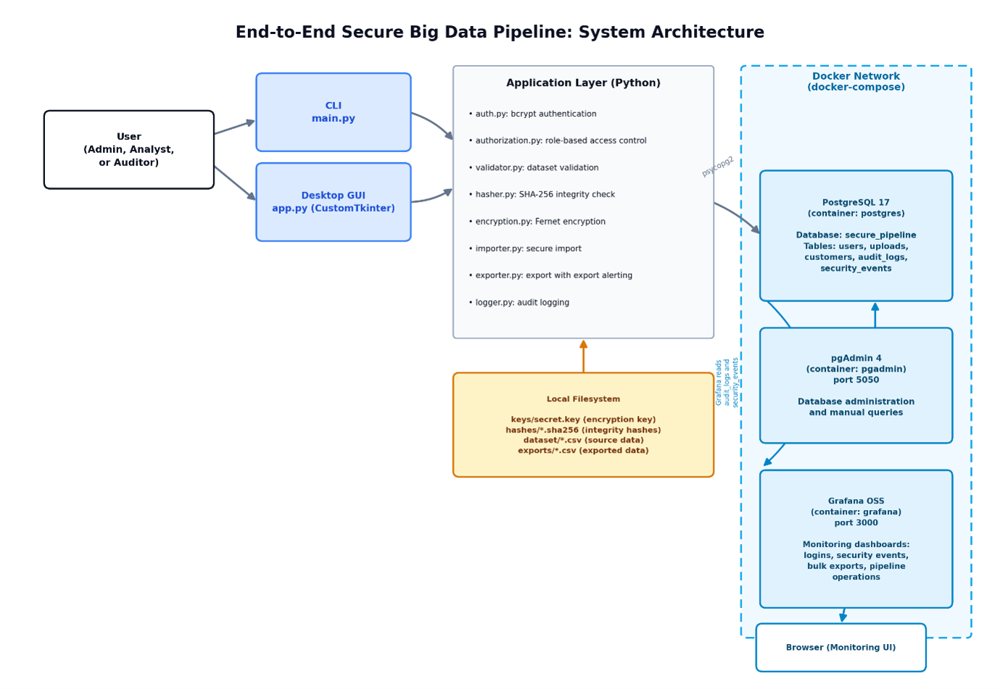
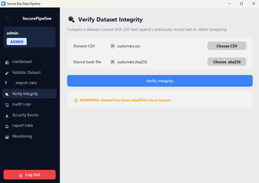

# End-to-End Secure Big Data Pipeline

A secure, end-to-end data pipeline built for **DSA 4030: Big Data Security**. The system ingests customer records, authenticates and authorizes users by role, encrypts sensitive fields, verifies data integrity, logs every action, and monitors the environment in real time - accessible through both a command-line interface and a desktop GUI.

**Group 17**

**My role:** I designed and built the entire system: the Docker environment, the PostgreSQL schema, the Python pipeline (validation, hashing, encryption, import and export), authentication and role-based access control, audit logging, the desktop GUI, and the security tests.

---

## Table of Contents

- [Overview](#overview)
- [Features](#features)
- [Architecture](#architecture)
- [Tech Stack](#tech-stack)
- [Project Structure](#project-structure)
- [Getting Started](#getting-started)
- [Usage](#usage)
- [Database Schema](#database-schema)
- [Roles & Permissions](#roles--permissions)
- [Security Testing](#security-testing)
- [Known Limitations](#known-limitations)
- [Roadmap](#roadmap)
- [License](#license)

---

## Overview

This project simulates a cybersecurity consulting engagement: securing the **entire lifecycle** of a client's big data environment — collection, secure storage, access control, monitoring, and integrity protection — then proving it with real security testing and simulated incidents.

A synthetic dataset of **100,000 Kenyan customer records** is generated with [Faker](https://faker.readthedocs.io/), moved through a pipeline that validates, hashes, encrypts, and imports it into PostgreSQL, with every step authenticated, authorized, and logged.

## Features

- 🔐 **bcrypt authentication** with three roles: Admin, Analyst, Auditor
- 🛡️ **Role-Based Access Control** enforced on every sensitive action, least-privilege by design
- 🔒 **Field-level encryption** (Fernet) on names, email, phone, and national ID
- 🧾 **SHA-256 integrity verification** to detect tampering after import
- 📜 **Full audit logging** of logins, imports, exports, permission denials, and integrity checks
- 📤 **Bulk export detection**, flagging exports over 50,000 records as a security event
- 📊 **Real-time monitoring** via a Grafana dashboard reading directly from PostgreSQL
- 🖥️ **Two interfaces, one backend** — a CLI and a CustomTkinter desktop GUI both enforce identical security logic

## Architecture

<p align="center">
  
</p>

The system runs as three Dockerized services (PostgreSQL, pgAdmin, Grafana) behind a Python application layer that implements every security control. Both the CLI and the desktop GUI call the same backend modules directly, so security behavior is identical regardless of which interface is used.

## Tech Stack

| Layer | Technology |
|---|---|
| Language | Python 3 |
| Database | PostgreSQL 17 |
| Containerization | Docker & Docker Compose |
| Authentication | bcrypt |
| Encryption | `cryptography` (Fernet) |
| Integrity | SHA-256 (`hashlib`) |
| Database admin | pgAdmin 4 |
| Monitoring | Grafana OSS |
| Synthetic data | Faker |
| Desktop GUI | CustomTkinter |
| Data handling | pandas |

## Project Structure

Run every command from the repository root.

```
End-to-End-Secure-Big-Data-Pipeline/
├── pipeline/
│   ├── main.py                 # CLI entry point and menu
│   ├── app.py                  # Desktop GUI entry point
│   ├── gui_adapters.py         # Bridges the GUI to the backend modules
│   ├── config.py               # Database settings (read from .env)
│   ├── database.py             # PostgreSQL connection
│   ├── auth.py                 # bcrypt authentication
│   ├── authorization.py        # RBAC permission definitions
│   ├── validator.py            # Dataset validation
│   ├── hasher.py               # SHA-256 hashing and verification
│   ├── encryption.py           # Fernet field-level encryption
│   ├── importer.py             # Secure import pipeline
│   ├── exporter.py             # Export with bulk-export detection
│   ├── logger.py               # Audit log writer
│   ├── viewer.py, security_viewer.py   # Audit log / security event viewers (CLI)
│   ├── verifier.py             # Integrity verification (CLI)
│   ├── workflow.py             # Validate/import orchestration (CLI)
│   └── ui/                     # Desktop GUI screens
├── database/schema.sql         # Full PostgreSQL DDL
├── dataset/
│   ├── generate_dataset.py     # Synthetic dataset generator (seeded)
│   └── customers.csv           # 100,000 synthetic customer records
├── hashes/                     # Stored SHA-256 hashes
├── docker-compose.yaml         # PostgreSQL, pgAdmin and Grafana
├── .env.example                # Template for credentials (copy to .env)
├── evidence/, tests_and_incidents/   # Screenshots from the security tests
└── Group17_Secure_Big_Data_Pipeline_Report (2).pdf
```

`keys/` (the encryption key), `exports/` and `.env` are created locally and are git-ignored, so no secrets are stored in the repository.

## Getting Started

### Prerequisites

- Python 3.10+
- Docker and Docker Compose
- `pip`

### 1. Clone and install dependencies

```bash
git clone https://github.com/Betelhemgetachew/End-to-End-Secure-Big-Data-Pipeline.git
cd End-to-End-Secure-Big-Data-Pipeline
pip install -r requirements.txt
```

### 2. Set your credentials

```bash
cp .env.example .env    # then edit .env and choose your own passwords
```

### 3. Start the environment

```bash
docker compose up -d
```

This starts three containers:

| Service | Port | Purpose |
|---|---|---|
| PostgreSQL | 5432 | Primary data store |
| pgAdmin | 5050 | Database administration |
| Grafana | 3000 | Security monitoring dashboards |

### 4. Create the tables

```bash
docker exec -i postgres psql -U admin -d secure_pipeline < database/schema.sql
```

(Use the `DB_USER` and `DB_NAME` values from your `.env` if you changed them.)

### 5. Generate the encryption key

```bash
python -c "import sys; sys.path.insert(0, 'pipeline'); from encryption import generate_key; generate_key()"
```

### 6. (Optional) Regenerate the dataset

```bash
python dataset/generate_dataset.py
```

### 7. Create user accounts

```python
import sys; sys.path.insert(0, "pipeline")
from auth import create_user
create_user("admin", "your_password", "ADMIN")
create_user("analyst", "your_password", "ANALYST")
create_user("auditor", "your_password", "AUDITOR")
```

## Usage

### Command-line interface

```bash
python pipeline/main.py
```

Log in and choose from the menu: validate a dataset, run the secure import pipeline, verify integrity, view audit logs, view security events, or export data.

<p align="center">
  
</p>

### Desktop GUI

```bash
python pipeline/app.py
```

The GUI mirrors the CLI's capabilities with a role-aware sidebar, a native file picker for imports, live progress feedback, and a one-click link to the Grafana dashboard. See screenshots below.

<p align="center">
  
</p>

### Monitoring

Open [http://localhost:3000](http://localhost:3000) for the Grafana dashboard, or [http://localhost:5050](http://localhost:5050) for pgAdmin.

## Database Schema

Five tables make up the `secure_pipeline` database:

| Table | Purpose |
|---|---|
| `users` | Accounts and bcrypt password hashes |
| `uploads` | Metadata for every imported dataset, including its SHA-256 hash |
| `customers` | Imported records, with sensitive fields encrypted |
| `audit_logs` | Every action performed in the system |
| `security_events` | A filtered view of failures, warnings, and permission denials |

Full DDL is in [`database/schema.sql`](database/schema.sql).

## Roles & Permissions

| Role | Validate | Import | Encrypt | Verify Integrity | View Audit Logs | View Security Events | Export |
|---|:---:|:---:|:---:|:---:|:---:|:---:|:---:|
| **Admin** | ✅ | ✅ | ✅ | ✅ | ✅ | ✅ | ✅ |
| **Analyst** | ✅ | — | — | ✅ | — | — | — |
| **Auditor** | — | — | — | ✅ | ✅ | ✅ | — |

Every check is enforced by [`pipeline/authorization.py`](pipeline/authorization.py), and every denial is logged.

## Security Testing

Nine security tests were executed against the running system, each with objective, procedure, expected/actual results, and evidence:

1. Authentication
2. Role-Based Access Control
3. Sensitive Data Encryption
4. Dataset Integrity Verification
5. Audit Logging
6. Secure End-to-End Pipeline Execution
7. Dataset Validation
8. Bulk Data Export Detection
9. Security Events Monitoring

Three simulated incidents (unauthorized login, privilege escalation, and dataset tampering) were also demonstrated and correctly detected, logged, and blocked. Full results, methodology, and evidence are documented in the project report.

## Known Limitations

- `pandas.read_sql()` raises a SQLAlchemy compatibility warning when used with a raw `psycopg2` connection; functionally correct but should be wrapped with `create_engine()`.
- The Grafana dashboard is opened in a browser rather than embedded in the desktop GUI (CustomTkinter cannot render web content natively).
- Credentials live in a local `.env` file and the encryption key in a local file (both git-ignored). That is fine for a prototype, but production would need a secrets manager.
- Testing is currently manual; there is no automated test suite or CI pipeline.
- The validator checks structure, duplicates, account types, balances and phone format (`+254` plus 9 digits), but not email format or national ID length.
- No multi-factor authentication or login rate limiting has been implemented.

## Roadmap

Improvements identified for an enterprise deployment:

- [ ] Centralized secrets management (Vault or a cloud KMS) instead of local key/credential files
- [ ] Multi-factor authentication and login throttling
- [ ] Append-only or write-once audit logging
- [ ] Automated backups with tested restoration
- [ ] TLS across PostgreSQL, pgAdmin, and Grafana
- [ ] Active alerting (Grafana alert rules or a SIEM) instead of manual dashboard review

## License

This project was developed for academic purposes as part of the DSA 4030 Big Data Security course.
